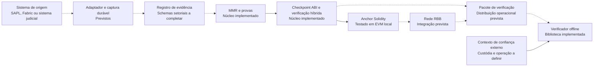

# Arkhe-RBB

**Camada de evidências verificáveis para aplicações públicas sobre a Rede Blockchain Brasil.**

O Arkhe-RBB propõe ligar atos produzidos por sistemas de governo a evidências assinadas, provas de inclusão e registros de ancoragem. O objetivo é permitir que um órgão, auditor ou cidadão confira o conteúdo de uma evidência e seu vínculo institucional usando um protocolo comum, com as condições de confiança declaradas.

Este repositório é um fork de [RBBNet/rbb](https://github.com/RBBNet/rbb). Ele reúne a proposta arquitetural e um núcleo experimental executável em [`arkhe/`](arkhe/README.md). A documentação de infraestrutura, adesão e governança herdada da RBB continua disponível; sua apresentação institucional foi preservada em [README-RBB.md](README-RBB.md).

> **Estado do projeto:** protocolo, verificação criptográfica, MMR e contrato experimental possuem implementação e testes locais/EVM. Integrações operacionais com SAPL, Fabric e rede RBB, registro institucional governado e infraestrutura de testemunhas permanecem pendentes. A publicação deste fork não representa aprovação, parceria formal ou implantação pela governança da RBB.

## Navegação

- [Propósito e contexto na RBB](#propósito-e-contexto-na-rbb)
- [Casos de uso nos três poderes](#casos-de-uso-nos-três-poderes)
- [Arquitetura e fluxo de evidências](#arquitetura-e-fluxo-de-evidências)
- [Protocolo, assinaturas e verificação](#protocolo-assinaturas-e-verificação)
- [Modelo de confiança e limites](#modelo-de-confiança-e-limites)
- [Estado da implementação](#estado-da-implementação)
- [Execução e validação](#execução-e-validação)
- [Governança, privacidade e operação](#governança-privacidade-e-operação)
- [Evolução e documentação](#evolução-e-documentação)

## Propósito e contexto na RBB

### O problema que o Arkhe procura resolver

Publicar um documento ou exibir uma informação em um portal não fornece, por si só, todos os elementos necessários para verificar sua origem, versão e cadeia de registros. Sistemas diferentes também podem representar o mesmo ato com formatos e regras incompatíveis.

O Arkhe organiza a evidência para responder a perguntas concretas:

1. Quais bytes representam o ato ou evento registrado?
2. Quais chaves assinaram essa evidência e a que órgão estavam vinculadas?
3. Em qual conjunto ordenado de registros ela foi incluída?
4. Qual checkpoint compromete esse conjunto e onde foi ancorado?
5. Que política foi aplicada, quais dados foram considerados e o que ficou sem verificação?

Essas respostas são propriedades verificáveis do pacote de evidências. A veracidade material do fato e sua validade jurídica continuam dependendo das fontes, das regras aplicáveis e das autoridades competentes.

### Como isso se relaciona com a RBB

A documentação de origem apresenta a RBB como uma rede público-permissionada criada por BNDES e TCU para aplicações de interesse público. Esse modelo combina possibilidade de leitura pública dos registros expostos com regras para participação, operação e envio de transações. A [referência institucional preservada](README-RBB.md) reúne o histórico e os documentos dessa organização.

A RBB fornece o contexto institucional e a infraestrutura de blockchain. O Arkhe é a camada de aplicação proposta neste fork: define como produzir, assinar, acumular e verificar evidências usando essa infraestrutura como destino de ancoragem.

| Dimensão | Papel da RBB | Papel proposto do Arkhe |
|---|---|---|
| Participação institucional | Regras de adesão, governança e operação compartilhada | Vincular a aplicação e seus responsáveis às autorizações aplicáveis |
| Rede e consenso | Infraestrutura Besu e configuração autorizada da rede | Submeter checkpoints sem alterar o consenso |
| Registro | Ordenação e persistência das transações aceitas pela rede | Registrar compromissos que identifiquem os bytes da evidência |
| Identidade da aplicação | Permissionamento de participantes e contas conforme configuração vigente | Associar órgãos, streams, operadores e conjuntos de chaves |
| Verificação | Disponibilidade de blocos, estado e dados conforme acesso à rede | Conferir assinaturas, inclusão, vínculo institucional e ancoragem sob um perfil explícito |

O [genesis de referência do observer](artefatos/observer/genesis.json) herdado neste repositório contém configuração QBFT. O Arkhe não modifica esse arquivo nem introduz assinaturas pós-quânticas no consenso. Versão do cliente, configuração EVM, endereços de contratos e permissionamento de uma implantação precisam ser confirmados para a rede de destino.

### Relação com os tipos de nó

Na topologia descrita pela documentação herdada, o publicador da aplicação se relacionaria com um **Writer** autorizado para enviar transações. **Observers** podem apoiar a leitura dos registros e a obtenção de dados para auditoria. **Validadores** e **Boot Nodes** mantêm suas funções de rede e consenso; executar a aplicação Arkhe não transforma automaticamente um participante em validador.

Subir um nó, ter uma conta autorizada e obter permissão institucional para um caso de uso são etapas distintas. Os roteiros de [adesão](roteiro_adesao.md), [adição de nós](roteiro_adicao_nos.md), [acesso de leitura](roteiro_acesso_leitura.md) e [rede de testes](roteiro_criacao_rede_teste.md) continuam sendo referências da infraestrutura RBB.

## Casos de uso nos três poderes

A proposta usa um núcleo comum de evidência e adapta a captura, a política e a exposição dos dados ao sistema de origem. Os cenários abaixo são **integrações previstas**, não conectores operacionais já entregues por este fork.

| Poder | Integração candidata | Evidência pretendida | Questão de auditoria |
|---|---|---|---|
| Legislativo | SAPL ou sistema equivalente | Intenção, ato, versões relevantes da matéria, resultado e checkpoint de sessão | A evidência corresponde à deliberação e à política identificadas? |
| Executivo | Sistemas setoriais e eventos Fabric autorizados | Evento confirmado, referência de origem e compromissos dos estados de entrada/saída | Qual evento de origem está vinculado ao registro ancorado? |
| Judiciário | Sistemas processuais e documentais autorizados | Versão de documento, evento processual e referências de custódia | Qual conteúdo foi preservado e quais mudanças constam da trilha? |

### Exemplo legislativo

No fluxo projetado para uma votação, o adaptador captura uma ocorrência identificada e sua revisão, associa a intenção correta e registra os elementos necessários para avaliar a política vigente. A evidência inclui os compromissos dos estados relevantes antes/depois, o resultado e a referência da política.

Os registros entram em um acumulador ordenado por órgão e stream. Ao fechar um lote, o produtor congela seu manifesto e a raiz MMR, constrói o checkpoint, obtém as assinaturas e o publica pelo caminho autorizado. Um pacote de verificação reúne a evidência, a prova de inclusão e os elementos necessários para conferir sua autorização e ancoragem.

O vínculo entre esses passos precisa ser demonstrado pela integração real. O protótipo atual testa o núcleo de protocolo e o contrato em ambiente local; não captura uma sessão SAPL real nem certifica a regularidade de uma votação.

## Arquitetura e fluxo de evidências

O desenho preserva o sistema setorial como origem do ato e concentra na camada Arkhe a produção e a verificação de evidências. A implantação inicial proposta mantém captura, progresso do MMR e lotes em armazenamento transacional, com publicação desacoplada da disponibilidade da blockchain.



O diagrama apresenta o fluxo de referência, incluindo partes ainda previstas. As ligações entre módulos implementados são exercitadas pelos testes; o serviço completo de produção, o assinador isolado e a distribuição pública de pacotes não estão implantados.

### Elementos principais

| Elemento | Função |
|---|---|
| **WER — registro de evidência** | Representar uma ocorrência de origem, sua revisão, os compromissos de conteúdo e as referências de política |
| **Stream** | Delimitar uma sequência de evidências pertencente a um órgão e a um contexto de produção |
| **MMR — Merkle Mountain Range** | Acumular registros e permitir verificar inclusão e extensão por meio de hashes |
| **Manifesto de lote** | Identificar o conjunto ordenado de registros comprometido por um checkpoint |
| **Checkpoint** | Vincular rede, contratos, órgão, stream, sequência, raiz, contadores, manifestos, política e chaves |
| **Anchor** | Registrar o ID e o compromisso do envelope, com as regras de admissão implementadas no contrato |
| **Atestação** | Vincular uma avaliação do checkpoint a testemunhas previamente confiadas pelo verificador |
| **ConstitutionGraph / ContainmentGate** | Desenho previsto para representar políticas versionadas e avaliar fatos; não há motor regimental operacional neste módulo |

### Registro, confirmação e aceitação

O desenho distingue três conclusões:

- **Registro:** uma conta autorizada submeteu o conteúdo admitido pelo contrato.
- **Confirmação:** a aplicação verificou recibo, evento e referência de bloco conforme o perfil da rede.
- **Aceitação da evidência:** o consumidor verificou as propriedades exigidas, incluindo assinaturas e contexto de confiança.

Uma transação aceita pela EVM não prova, isoladamente, que a assinatura ML-DSA, a evidência de origem ou a política são válidas. A arquitetura também mantém separado o resultado de conformidade: uma evidência íntegra pode documentar uma violação de regra.

## Protocolo, assinaturas e verificação

O código corresponde ao candidato **`arkhe-evidence/3`, revisão 2**, ainda experimental. Seus bytes não são intercambiáveis com os exemplos v2 ou com o checkpoint CBOR/BLAKE3 descrito na especificação v0.1.

### Cabeçalho e envelope

O checkpoint possui um cabeçalho ABI estático de **27 palavras, 864 bytes**. O contrato e as bibliotecas recalculam o mesmo identificador com Keccak-256 e separação de domínio. Os campos incluem identidade de rede/genesis, contratos, órgão, stream, sequência, predecessor, intervalo de folhas, raiz MMR, manifestos, política, IDs das chaves e perfil MMR.

O envelope agrega o cabeçalho e as duas assinaturas. No perfil implementado, sua codificação ABI ocupa **3.488 bytes**. O compromisso do envelope é independente do significado que um portal atribua aos dados: alterações nos bytes precisam ser detectáveis pela verificação correspondente.

O decoder Rust rejeita offsets, padding, larguras, flags e comprimentos não canônicos, além de bytes extras e intervalos inválidos. Os testes diferenciais comparam bytes e hashes produzidos em Rust, Python e Solidity.

### Assinaturas híbridas

O perfil inicial exige **Ed25519 AND ML-DSA-44** sobre o mesmo digest de checkpoint. A verificação ML-DSA usa a implementação `fips204` fixada no projeto e contextos distintos para checkpoint e atestação.

ML-DSA é o algoritmo padronizado em [FIPS 204](https://csrc.nist.gov/pubs/fips/204/final). A padronização do algoritmo não certifica esta implementação nem demonstra proteção pós-quântica de toda a RBB: contas EVM, administração, consenso, transporte e recuperação de chaves mantêm suas próprias dependências de segurança.

O protótipo não pressupõe disponibilidade da EIP-8051 nem executa uma precompile PQ na EVM. O exemplo de assinatura contém seeds públicas e serve exclusivamente para testes; não é um serviço de assinatura de produção.

### MMR e continuidade

O perfil MMR implementado usa BLAKE3, separação de domínio e vínculo entre raiz e contador de folhas. A verificação de inclusão confere posição, geometria das montanhas, irmãos e picos esperados. A função de extensão recompõe o crescimento a partir de uma frontier anterior autenticada.

Provar que um registro pertence a uma raiz e provar que a sequência cresceu sem reescrever seu prefixo são verificações diferentes. O perfil tem identidade própria e não substitui silenciosamente outros perfis MMR do ecossistema Arkhe.

## Modelo de confiança e limites

O verificador precisa receber seu contexto de confiança por um canal independente do pacote avaliado. Chaves, snapshots ou testemunhas fornecidos pelo próprio produtor não se tornam confiáveis apenas por acompanhar assinaturas matematicamente válidas.

O modo implementado na biblioteca é **`TRUSTED_ATTESTATION`**. Ele verifica uma avaliação assinada por pelo menos **3 entre 4 testemunhas** configuradas pelo host, com IDs e chaves distintas e assinaturas híbridas. Não há serviço real de testemunhas operado por este repositório; seleção de participantes, custódia e atualização da raiz permanecem tarefas de implantação.

| Propriedade | O que deve ser conferido | Limite da conclusão |
|---|---|---|
| Integridade do conteúdo | Hashes e compromissos definidos pelo perfil | Não determina se o fato declarado ocorreu |
| Assinatura do checkpoint | Ambas as famílias de assinatura e seus contextos | Não atribui sozinha identidade institucional à chave |
| Vínculo institucional | Registro/keyset e atestação sob uma raiz confiada | Depende das autoridades e testemunhas selecionadas |
| Inclusão MMR | Posição, contador, prova e raiz correspondente | Não demonstra completude de toda a origem |
| Ancoragem | Identidade do checkpoint, compromisso, rede e referência autenticada | O modo atual confia na atestação; não é light client QBFT |
| Continuidade | Extensão a partir de estado anterior autenticado | O leitor precisa obter a referência anterior correta |
| Tempo e frescura | Registro da primeira ancoragem, validade, revogação e relógio quando disponível | Data autodeclarada não prova anterioridade; pacote antigo não demonstra estado atual |
| Política | Regra versionada, fatos e avaliação correspondente | O motor regimental e os schemas completos ainda são previstos |

As funções da biblioteca verificam propriedades delimitadas. `verify_attested_checkpoint` não declara ter verificado um WER ou uma prova de inclusão; a inclusão MMR é conferida pela função específica. O produtor e o consumidor precisam compor as verificações exigidas pelo caso de uso.

## Estado da implementação

| Componente | Estado neste fork | Referência |
|---|---|---|
| Codec do cabeçalho/envelope e IDs | Implementado e testado | [header.rs](arkhe/protocol/src/rbb/header.rs) |
| MMR, inclusão e extensão | Implementado e testado | [mmr.rs](arkhe/protocol/src/rbb/mmr.rs) |
| Assinaturas híbridas e confiança offline 3/4 | Implementado e testado como biblioteca | [trust.rs](arkhe/protocol/src/rbb/trust.rs) |
| Contrato de ancoragem | Experimental, executado em EVM local | [ArkheCheckpointAnchor.sol](arkhe/contracts/ArkheCheckpointAnchor.sol) |
| Registro institucional | Fixture de teste; implementação governada pendente | [RegistryFixture.sol](arkhe/contracts/fixtures/RegistryFixture.sol) |
| Vetores e oráculo independente | Implementados | [fixtures](arkhe/fixtures/protocol-v3.json) e [Python](arkhe/python/reference_vectors.py) |
| Captura SAPL e ponte Fabric | Arquitetura proposta; conexão real pendente | [Especificação](arkhe/docs/ARKHE-RBB-ESPECIFICACAO-TECNICA-v0.2.md) |
| PostgreSQL/outbox e recuperação após falhas | Projeto definido; implementação e ensaios pendentes | [Arquitetura](arkhe/docs/ARKHE-RBB-ARQUITETURA-v0.2.md) |
| Políticas regimentais e avaliação de atos | Desenho proposto; validação normativa e implementação pendentes | [Revisão](arkhe/docs/ARKHE-RBB-REVISAO-SEGURANCA-2026-10-28.md) |
| HSM, testemunhas e raiz operacional | Pendentes | [Modelo de confiança](arkhe/docs/ARKHE-RBB-ARQUITETURA-v0.2.md) |
| Deploy e homologação na RBB | Pendentes | [Escopo de execução](arkhe/docs/EXECUCAO.md) |

O `RegistryFixture` possui setters públicos e não deve ser utilizado como registro institucional. O anchor experimental também possui administração única para configuração e pausa. Esses limites precisam ser tratados antes de uma implantação operacional.

## Execução e validação

### Validação já realizada

Na correção de CI registrada em 28/10/2026, as execuções de [push](https://github.com/rafael-arkhe/rbb-arkhe/actions/runs/40790869436) e [pull request](https://github.com/rafael-arkhe/rbb-arkhe/actions/runs/40790896780) passaram no commit `4765d02e02fb51f7d850e461fc1041c72a219ff2`:

- **15 testes Rust**, cobrindo protocolo/MMR e assinatura/confiança.
- **9 testes EVM**, incluindo o mesmo checkpoint assinado em Rust e registrado pelo contrato.
- **1 teste de regressão do lockfile**, além dos testes EVM.
- Oráculo Python de ABI/Keccak e oito raízes MMR.
- Clippy com `-D warnings`.

São resultados de execução do protótipo local em runner Windows. Não são benchmarks da rede RBB, certificação criptográfica ou testes de integração com sistemas institucionais reais. O [relatório de execução](arkhe/docs/EXECUCAO.md) e o [resumo versionado](arkhe/docs/TEST-RESULTS.json) delimitam o alcance.

### Executar o conjunto completo

O caminho validado pelo runner utiliza **PowerShell 7, Rust 1.96.0, Python 3.14 e Node 22 com npm 10.9.9**. Rust/rustup, Node/npm e Python precisam estar instalados. A primeira execução baixa dependências dos registros correspondentes.

A partir da raiz do checkout, no PowerShell:

```powershell
npm.cmd install --global npm@10.9.9 --ignore-scripts --no-audit --no-fund
python -m venv arkhe/.venv
.\arkhe\.venv\Scripts\python.exe -m pip install -r arkhe/python/requirements.txt
rustup toolchain install 1.96.0 --profile minimal --component clippy
pwsh -NoProfile -File arkhe/run-tests.ps1 -Python ".\arkhe\.venv\Scripts\python.exe" -InstallNodeDependencies
```

O runner verifica os vetores existentes, executa os testes Rust, compila o exemplo de assinatura, executa a EVM local e roda Clippy. Logs e resultado estruturado são gravados em `arkhe/test-results/`, diretório ignorado pelo Git. Nas repetições, a instalação Node pode ser omitida se as dependências já estiverem disponíveis.

O ambiente EVM de teste usa **solc 0.8.30, alvo Shanghai e chain ID 1337**. Esses parâmetros são do laboratório local, não a configuração declarada da RBB. O lockfile preserva o caráter opcional de `fsevents`, exclusivo do macOS, para permitir instalação limpa no Windows.

Comandos por etapa e a variável `ARKHE_RBB_FIXTURE_BIN`, para quem usa diretório de build alternativo, estão no [guia técnico do módulo](arkhe/README.md). Este README pode ser lido sem executar ou instalar os componentes.

## Governança, privacidade e operação

### Identidade e governança da aplicação

O registro institucional proposto deve separar órgão, operador EVM, assinador de evidências, administrador e testemunha. Rotação, revogação, recuperação e mudança de política precisam preservar histórico e possuir autorização verificável. A proteção contra replay deve vincular finalidade, rede, contrato, órgão, versão e nonce conforme o mecanismo de autorização escolhido.

A adesão à RBB, o direito de operar um Writer ou validador e a aceitação deste caso de uso dependem dos processos aplicáveis à rede. Os nomes de sistemas e instituições usados na proposta descrevem contextos ou candidatos de integração; não demonstram acordos assinados ou serviços já conectados.

### Privacidade e disponibilidade

Dados necessários à verificação devem ser minimizados e separados conforme seu nível de acesso. Hashes podem continuar permitindo correlação ou reidentificação; não há garantia automática de anonimização ou conformidade com a LGPD. Documentos e dados sensíveis não devem ser publicados na cadeia por conveniência da prova.

A disponibilidade dos bytes também é requisito: possuir um hash ancorado não permite reconstruir um pacote perdido. A arquitetura prevê retenção, backups, recuperação, reconciliação e tratamento de gaps; esses mecanismos operacionais ainda precisam ser implementados e ensaiados.

### Políticas e conformidade

A proposta de ConstitutionGraph/ContainmentGate procura tornar explícita a política usada para avaliar um ato. Cada política precisa indicar autoridade, jurisdição, versão, vigência, parâmetros e fatos necessários. Regras ilustrativas não se tornam automaticamente aplicáveis a toda casa legislativa ou órgão.

Resultados de integridade, conformidade e cobertura devem ser apresentados separadamente. Uma regra ausente ou uma pré-condição não verificada não deve aparecer como aprovação. A implementação de um avaliador não substitui a decisão institucional ou jurídica competente.

## Evolução e documentação

### Próximos marcos

| Marco | Entrega necessária | Critério de avanço |
|---|---|---|
| Congelamento do protocolo | Schemas setoriais, catálogo de perfis e contratos de dados completos | Vetores e revisão de interoperabilidade aprovados |
| Captura durável | Outbox, armazenamento, ordenação e fechamento por watermark | Ensaios de concorrência, reinício e reconciliação |
| Governança de chaves | Registro institucional, autorização e recuperação | Rotação/revogação e incidentes testados |
| Confiança operacional | Raiz distribuída e testemunhas independentes | Custódia, atualização e atestação demonstradas |
| Integração setorial | Adaptadores SAPL/Fabric ou outro sistema autorizado | Origem e cobertura comprovadas em ambiente de teste |
| Homologação e piloto | Configuração RBB autorizada, privacidade e operação | Aceite dos responsáveis e recuperação/capacidade medidas |

O cronograma depende dessas evidências e das decisões institucionais. A execução do núcleo local permite avaliar o protocolo; não antecipa a conclusão desses marcos.

### Documentos do Arkhe

| Documento | Conteúdo |
|---|---|
| [Guia do módulo](arkhe/README.md) | Estrutura de código, comandos e limitações de implementação |
| [Arquitetura v0.2](arkhe/docs/ARKHE-RBB-ARQUITETURA-v0.2.md) | Componentes, transações, confiança, falhas e decisões de implantação |
| [Especificação técnica v0.2](arkhe/docs/ARKHE-RBB-ESPECIFICACAO-TECNICA-v0.2.md) | Formatos, invariantes, requisitos e critérios de aceitação |
| [Revisão de arquitetura e segurança](arkhe/docs/ARKHE-RBB-REVISAO-SEGURANCA-2026-10-28.md) | 17 achados sobre o material inicial, com impactos e tratamentos propostos |
| [Execução e alcance](arkhe/docs/EXECUCAO.md) | Implementação entregue, reprodução e correção de CI |
| [Resumo dos testes](arkhe/docs/TEST-RESULTS.json) | Resultados versionados e limites da validação |
| [Proveniência](arkhe/PROVENANCE.json) | Arquivos de origem e adaptações da portabilidade inicial |

### Referências da RBB preservadas

Consulte a [apresentação institucional de origem](README-RBB.md), os diretórios de [arquitetura](arquitetura/), [documentos](documentos/) e [governança](governanca/), além dos roteiros de operação. O [repositório RBBNet/rbb](https://github.com/RBBNet/rbb) permanece a referência de origem deste fork.

Listas de participantes, endpoints e instruções herdadas devem ser conferidos com a documentação vigente antes de operação. A proposta Arkhe, sua licença de código e seus responsáveis devem ser avaliados conforme os arquivos e avisos aplicáveis; a [licença do repositório herdado](LICENSE) permanece disponível na raiz.
