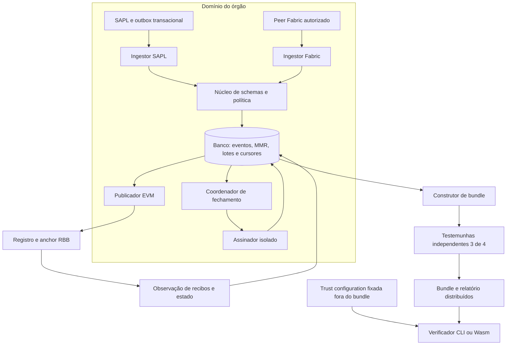
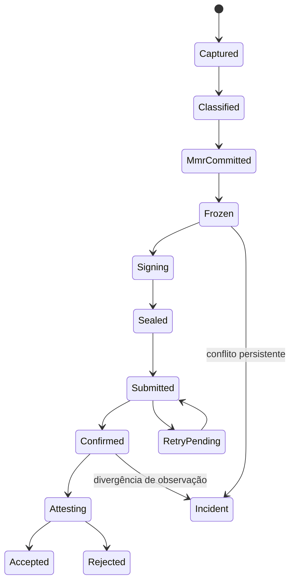

# Arkhe–RBB — arquitetura aprimorada v0.2

Data: 28/10/2026. Estado: desenho de referência, sem implantação. Documento normativo complementar à [especificação v0.2](ARKHE-RBB-ESPECIFICACAO-TECNICA-v0.2.md). Os valores de quórum e limites abaixo são decisões propostas para o piloto, não descrição de instituições ou infraestrutura já contratadas.

## 1. Decisões centrais

| Decisão | Ganho concreto | Custo ou limite |
|---|---|---|
| Núcleo determinístico compartilhado, sem IO | Mesmo codec e verificação em serviço, CLI e Wasm | Adaptação explícita dos perfis existentes |
| Cabeçalho estático ABI, assinado e recalculado pela EVM | Elimina divergência entre envelope e metadados indexados | Incompatibilidade com a proposta v0.1 |
| CBOR para WER, manifestos e atestações | Schemas setoriais extensíveis fora do contrato | Vetores diferenciais por linguagem continuam obrigatórios |
| Um banco transacional para evento, MMR e progresso | Recuperação local sem commit distribuído | Escala por stream; retenção e backup precisam ser dimensionados |
| Banco durável como fila de trabalho do piloto | Broker deixa de ser dependência de correção | Polling, índices e controle de concorrência necessários |
| Atestação de 3 entre 4 testemunhas independentes | Resolve vínculo institucional offline sob confiança declarada | Não equivale a light client QBFT |
| Aceitação criptográfica separada de registro on-chain | Operador EVM não consegue, sozinho, produzir selo válido | Pode registrar lixo e causar incidente de disponibilidade |
| Fluxo de auditoria separado de conformidade | Violação de regra permanece documentada | UI e políticas precisam distinguir todos os resultados |
| Um lote aguardando aceitação por stream no piloto | Simplifica predecessor, retries e recuperação de conteúdo inválido | Limiar de testemunhas também condiciona o próximo fechamento |

As fontes primárias consultadas fundamentam regras de encoding, locks e autorização; as combinações e decisões acima são desenho deste projeto. Referências: [ABI Solidity](https://docs.soliditylang.org/en/latest/abi-spec.html), [locks PostgreSQL](https://www.postgresql.org/docs/current/explicit-locking.html), [CBOR](https://www.rfc-editor.org/rfc/rfc8949.html) e [EIP-712](https://eips.ethereum.org/EIPS/eip-712).

## 2. Topologia mínima e limites dos componentes

O piloto roda um serviço modular de evidências e um processo de publicação, com credenciais distintas, banco durável e assinador isolado. Não requer microserviço por módulo, Kafka, cluster Kubernetes ou alteração de Besu. A separação em bibliotecas e permissões precede a separação em serviços. Testemunhas são implantações independentes: quatro processos no mesmo host ou sob a mesma credencial não satisfazem o objetivo de independência.



| Módulo | Entrada | Saída | Efeito externo permitido |
|---|---|---|---|
| `protocol` | Bytes e schema/profile ID | Tipos validados, digests e erros | Nenhum |
| `policy` | Fatos e política autenticada | Resultado reproduzível e evidências usadas | Nenhum no avaliador |
| `ingestion` | Evento autenticado | Evento normalizado durável | Ler origem e gravar inbox |
| `sequencer` | Evento capturado e classificado | Folha, frontier e ordem | Transação no banco |
| `sealer` | Watermark completo e frontier | Lote imutável e pedido de assinatura | Banco e chamada ao assinador |
| `signer` | Digest, header, referência do lote e perfil | Assinaturas e ID auditável da operação | Serviço de chaves |
| `publisher` | Envelope persistido | Transação EVM e tentativas | Nó Writer autorizado |
| `observer` | Recibo/bloco/contrato esperado | Observação e confirmação | RPC de leitura |
| `witness` | Bundle candidato e contexto confiado próprio | Atestação ou recusa tipada | Fontes independentes de leitura |
| `verifier` | Bundle e trust configuration | Relatório por propriedade | Nenhum no modo offline |

## 3. Integração com o workspace existente

Inspeção realizada em interfaces e arquivos selecionados; não constitui auditoria integral dessas crates nem prova de compatibilidade.

| Código observado | Uso arquitetural candidato | Condição para reuso |
|---|---|---|
| `verification/crates/arkhe-verify-core` | Codec, MMR, verificação e relatórios | Adicionar namespace/perfil Arkhe-RBB; manter comportamento dos perfis atuais |
| `verification/crates/arkhe-verify-wasm` | Interface de verificação offline | Mesma biblioteca determinística, limites e vetores |
| `storage/sql/crates/arkhe-sql` | Persistência transacional, tenant e MMR | Migrações aditivas e invariantes do stream; conferir isolamento/constraints reais |
| `governance/arkhe-governance` | Políticas autenticadas e resultado inconclusivo | Adaptar fatos legislativos; não confundir autorização de agentes com regras regimentais |
| `evidence/arkhe-wormgraph` | Interfaces de armazenamento e infraestrutura | A fachada `WormGraph` lida mantém registros em `HashMap`; não assumir que ela é o acumulador MMR persistente exigido |

O perfil SQL consultado reexporta constantes de `arkhe-verify-core::mmr::profile`; essa autoridade compartilhada deve ser preservada. Domínios, composição de raiz e prova da especificação v3 não substituem silenciosamente aquele perfil. Antes da implementação, comparar ambos com vetores; escolher reuso integral de perfil compatível ou namespace e streams novos. Migrar um stream exige checkpoint de encerramento e vínculo ao sucessor; nunca recodificar evidência histórica como se tivesse sido produzida pelo novo perfil.

Dependências apontam para dentro: adaptadores → protocolo/política/storage; verificador → protocolo; protocolo não importa Django, RPC, SQL, Celery ou chaves privadas. O publicador não possui permissão para trocar políticas ou cadastrar órgãos. O processo de assinatura não recebe instruções arbitrárias extraídas de WER.

## 4. Cabeçalho único e admissão no contrato

A v0.1 admitia envelope CBOR e projeção EVM divergentes. Nesta revisão a tupla estática é o único cabeçalho autoritativo. Ela contém rede/genesis, contratos, órgão, stream, sequência, predecessor, intervalo de folhas, root, manifestos, política, chaves, flags de presença e digest do perfil MMR. A EVM recalcula seu ID usando Keccak-256 e reconstrói o envelope com ABI canônica. WER e MMR continuam fora do contrato.

Isso fecha a ambiguidade dos bytes registrados. Não resolve, isoladamente, a autenticidade de uma assinatura ML-DSA: no piloto essa propriedade é validada pelo assinador, verificador e testemunhas; o contrato continua declarando `RECORDED`.

Admissão lógica:

1. Calcular ID e compromisso a partir da tupla e assinaturas recebidas, validando tamanhos e campos canônicos.
2. Se `(org, stream, seq)` já existe: conteúdo exatamente igual retorna o resultado histórico sem novo evento de inserção; divergência retorna `SequenceConflict`.
3. Para nova entrada: conferir operador/época autorizada, órgão/stream ativos, rede e endereços iguais ao deploy, perfil permitido, keyset cadastrado e intervalos do registro.
4. Exigir `seq == last_seq + 1`, predecessor igual ao último ID, primeira folha igual ao contador anterior e soma sem overflow igual ao contador novo. Sequência 1 exige predecessor ausente e primeira folha zero.
5. Registrar ID/compromisso, root, contadores e referência do keyset. O contrato não afirma ter verificado root MMR, política, fonte Fabric ou assinaturas híbridas.

O `anchor_genesis_hash` deve ser fixado no deploy e também comparado pelo verificador à rede de sua trust configuration; o contrato não tem consulta automática ao genesis via opcode.

**Registro defeituoso por operador autorizado:** o contrato pode receber assinaturas inválidas com tamanho correto. A confirmação de transporte permanece verdadeira; a aceitação criptográfica falha. Suspender publicador/stream, preservar evidência do incidente e criar stream sucessor por governança, ligado ao último checkpoint aceito. Não permitir sobrescrita nem avanço tácito sobre a falha. Atestadores e leitores devem reportar também o registro defeituoso observado. Prevenir toda admissão criptograficamente inválida on-chain é requisito adicional de uma versão futura, com custo medido.

## 5. Modelo de persistência e invariantes

O banco do serviço é a fonte operacional de verdade. O armazenamento publicado por hash é réplica/exportação; não decide se um evento foi capturado ou ancorado. No piloto, bytes autoritativos de WER, manifestos e envelope permanecem no banco, sujeitos aos limites de tamanho. Objetos maiores precisam de protocolo de staging e commit próprio, fora deste piloto.

| Entidade | Chave/constraints mínimas | Estado protegido |
|---|---|---|
| `streams` | PK `(org_id, stream_id)`; perfil e origem fixos | `revision`, `next_leaf`, frontier, `last_sealed_seq`, `last_confirmed_seq`, `last_accepted_seq`, status |
| `source_events` | UNIQUE `(org, source_network, event_id, revision)` | Bytes de origem, digest, estado da captura e classificação |
| `source_cursors` | PK `(org, source_network, partition)` | Posição observada e posição inteiramente persistida |
| `policy_evaluations` | UNIQUE `(event_id, policy_digest, evaluator_version)` | Entradas/digests, resultado e códigos |
| `mmr_leaves` | UNIQUE `(org, stream, index)` e `(org, stream, source_event_revision)` | Hash e referência ao WER |
| `mmr_nodes` | UNIQUE `(org, stream, height, start_index)` | Material necessário às provas históricas |
| `checkpoint_batches` | UNIQUE `(org, stream, sequence)` e `checkpoint_id` | Frontier congelada, watermark, manifesto, header e envelope imutáveis |
| `sign_requests` | UNIQUE `(checkpoint_id, keyset_version)` | Digest autorizado, operação do assinador e resultado persistido |
| `publication_attempts` | ID da tentativa; vínculo ao checkpoint | Conta, nonce EVM, tx hash, substituição e receipt |
| `account_nonces` | PK `(chain_id, genesis_hash, publisher_address)` | Reserva serializada de nonce da conta |
| `witness_votes` | UNIQUE `(assessment_digest, witness_id)` | Assinaturas, conjunto/época e validade |
| `incidents` | ID imutável; vínculos ao stream e origem | Gaps, conflitos de identidade, frozen stream e resolução |

Impor FKs com órgão/stream para impedir vínculo cruzado entre tenants. Constraints do banco, não apenas checagens de aplicação, protegem unicidade. IDs de revisão idênticos com bytes diferentes são `SourceConflict`, preservados em incidente; não usar `ON CONFLICT DO NOTHING` sem comparação. O mesmo hash de conteúdo pode ocorrer em eventos legítimos distintos e não substitui a chave de ocorrência.

Para compatibilidade com armazenamento SQL existente em `i64`, o perfil operacional limita índices, contadores e sequências a `0..2^63−1`, ainda que o wire use uint64. O verificador pode reconhecer o limite mais amplo do protocolo; o produtor não deve truncar. Perfis/stream config publicados explicitam esse limite.

### 5.1 Append atômico

```text
BEGIN
  SELECT stream FOR UPDATE
  conferir estado, perfil, revisão e ordem da origem
  localizar evento por chave idempotente
  se já inserido: devolver índice existente
  obter próximo evento elegível segundo ordem persistida
  calcular folha e fusões a partir da frontier bloqueada
  INSERT folha e nós novos
  UPDATE frontier, contador e revisão do stream
  UPDATE evento com índice atribuído
COMMIT
```

Não fazer RPC ou assinatura dentro desse lock. O lock dura apenas o cálculo e a gravação local. Claim em tabela de trabalho pode usar leases e `SKIP LOCKED` entre streams, mas não autoriza pular evento anterior dentro de um stream. Após claim, o lock do stream e a revisão persistida continuam sendo a autoridade. Lease expirado nunca dá a um worker antigo o direito de sobrescrever estado mais novo.

### 5.2 Ordenação e watermark

Fabric fornece ordem `(block, tx, event)` dentro do canal. SAPL exige sequência/revisão de captura persistida no serviço transacional: PK auto-incremento não é, por si só, ordem de commit nem prova de ausência de lacunas. Fechamento deve usar barreira serializada por stream ou snapshot consistente da origem com conjunto de eventos de fechamento identificado. Cada adaptador deve demonstrar essa propriedade.

O lote fecha somente depois de normalizar e classificar todas as ocorrências até a barreira. Resultado de política FAIL é evidência de violação, não um buraco descartado. Evento estruturalmente ilegível produz incidente vinculado ao ID de origem, sem inventar WER válido. Enquanto isso, o relatório de completude daquele intervalo fica `GAP` e o lote não recebe atestação de cobertura completa.

O MMR é cumulativo; o manifesto do lote cobre exatamente a extensão `[old_count, new_count)`. Sessão plenária é agrupamento semântico e não redefine o contador. Um lote pode cobrir uma sessão ou parte dela, mas a UI só anuncia sessão completa quando sua barreira está satisfeita.

## 6. Captura e disponibilidade

Dois modos de captura precisam de nomes e contratos distintos:

| Modo | Garantia | Comportamento em falha local |
|---|---|---|
| `ATOMIC_OUTBOX` — referência do piloto | Ato e evento capturados na mesma transação da origem | Se a outbox não puder ser persistida, a transação falha; falha de broker/RBB não afeta commit |
| `RECONCILED_CAPTURE` — opcional | Continuidade de negócio com cobertura demonstrada por journal/CDC independente | Falha gera gap reconciliável; completude só após conferência do journal |

O segundo modo só pode ser habilitado quando existe trilha durável independente que registra a mudança e permite replay. Log de aplicação ou `try/except` não fornecem essa garantia. A escolha operacional deve ser aceita pelo responsável pelo sistema de origem; não presumir que falha de evidência pode bloquear um ato público. Enquanto não houver essa decisão, integração não está pronta para produção. A arquitetura distingue indisponibilidade remota, que é desacoplada, de falha no próprio commit local.

No SAPL, dispatcher lê outbox durável e o ingestor confirma recebimento após commit no banco Arkhe. Se houver dois bancos, essa etapa é entrega at least once, com chave idempotente no destino; não transação distribuída. Só remover/marcar entregue na origem após ACK durável. Para reconstruir estado antes/depois, o payload da outbox contém a captura relevante da transação original, em vez de reler estado mutável dias depois.

No Fabric, persistir a fronteira completa antes de avançar cursor. Reinício relê bloco de fronteira e deduplica tx/evento; stream remoto e cursor local nunca são tratados como entrega exatamente uma vez. A confiança em peer e ponte continua declarada.

## 7. Fechamento, assinatura e publicação



`CLASSIFIED` não implica PASS. `FROZEN` congela manifesto/header/watermark; `SEALED` acrescenta as duas assinaturas. `CONFIRMED` significa registro observado sob perfil de finalidade; `ACCEPTED` exige atestação e verificações do perfil. Um relatório pode registrar integridade de ato com política FAIL, sem apresentá-lo como conformidade normativa.

### 7.1 Serviço de assinatura

Recebe header completo, digest recalculado, ID do lote e referências de política/keyset. Recalcula o digest em implementação própria do mesmo protocolo, aplica autorização de órgão/stream e mantém ledger `(org, stream, seq, checkpoint_id)` para não assinar corpos divergentes na mesma sequência. A operação possui idempotency key; repetição devolve o resultado durável anterior quando disponível. Restringir uso da chave ao domínio de evidência previsto.

Queda antes de persistir uma assinatura pode obrigar nova tentativa com outra aleatoriedade ML-DSA; isso é permitido antes de SEALED e antes de qualquer submissão. O primeiro envelope selado durável se torna a única versão publicável. Antes de selar, deve-se ter prova de que não houve submissão antecipada por nenhum processo. Se a política do assinador exige saída exatamente reproduzível por operação, a própria implementação do assinador deve persistir o resultado.

### 7.2 Conta EVM e confirmações

Um publicador por conta EVM reserva nonce no banco com lock por conta, inclusive quando publica para streams diferentes. Restrição única ingênua do nonce por tentativa não é suficiente porque substituições podem compartilhar nonce: manter transação lógica por nonce e tentativas vinculadas a ela. Nunca compartilhar a chave da conta com emissores externos que não participam dessa reserva.

Em timeout: consultar tx hash e depois `(org, stream, seq)` no anchor, conferir ID/compromisso. Se já existe exatamente, reconciliar; se diverge, incidente; se ausente, reapresentar transação ou substituí-la segundo regras da rede fixada. Nonce pendente bloqueia ou exige tratamento explícito dos próximos, não criação de nova sequência de checkpoint.

Confirmação exige receipt com sucesso, contrato e evento esperados, ID/compromisso e bloco da rede correta. A regra de finalidade do perfil de rede é fixada na configuração; múltiplos RPC ajudam a detectar divergência, mas acordo entre RPCs não é prova criptográfica de consenso.

### 7.3 Fila por stream

Para o piloto, há no máximo um lote FROZEN ou posterior ainda não ACCEPTED por stream. O ingestor e MMR podem avançar além da frontier congelada, preservando snapshot e nós; o próximo lote só congela depois da aceitação do anterior. Assim, um registro criptograficamente defeituoso não ganha uma cauda de novos checkpoints antes da detecção. O pipeline interstreams é paralelo. Se publicação, assinatura ou atestação acumular atraso, aplicar backpressure e alertar por capacidade disponível; não descartar eventos nem lançar lote vazio. Pipelining antes da aceitação fica para versão posterior, com tratamento de cauda inválida demonstrado.

## 8. Confiança autenticada e atestação

### 8.1 Raiz externa

O verificador é instalado com `TrustConfigV1` cujo digest é fixado por canal separado do bundle. Esse documento contém: versão/época, identidade de rede/genesis e contratos/code hashes, catálogo de protocolos/perfis MMR e criptográficos, autoridades institucionais, testemunhas e suas duas chaves, quóruns, política temporal, limites de pacote e histórico de revogação.

Proposta para piloto: raiz administrativa de 2 entre 3 custodiantes independentes; conjunto de 4 testemunhas com limiar 3. Cada voto usa Ed25519 AND ML-DSA-44 para o mesmo digest, com contexto ML-DSA `ARKHE_RBB_ATTEST_V1`. A raiz administrativa assina atualizações de trust configuration com contexto distinto `ARKHE_RBB_TRUST_V1`. A identidade e a custódia desses participantes ainda precisam ser escolhidas; não são nomes de instituições presumidas.

Atualização exige versão monotônica, digest do predecessor e autorização pela raiz previamente confiada; mudança de chaves raiz deve ser autorizada pela raiz anterior e pela nova antes da ativação. Recuperação excepcional é procedimento externo auditável com redistribuição explícita da raiz, não uma autoautorização trazida pelo pacote.

O aplicativo persiste a maior versão confiada para evitar rollback. Instalação nova e modo offline só possuem a versão recebida de forma confiável; não podem descobrir revogação posterior sem atualização. Relatórios sempre informam a versão da raiz e bloco de referência.

### 8.2 Transcript de avaliação

`AssessmentV1` é CBOR determinístico com as chaves inteiras abaixo. Não contém assinaturas em sua própria preimagem.

| Chave | Campo |
|---:|---|
| 0 | Versão, exatamente 1 |
| 1 | Digest da trust configuration e época do conjunto de testemunhas |
| 2 | Identidade de rede: chain ID, genesis |
| 3 | Bloco de referência: número, hash e state root observados |
| 4 | Registro e anchor: endereços e code hashes |
| 5 | Órgão, stream, sequência e checkpoint ID |
| 6 | Compromisso do envelope e digest do manifesto de evidências fornecidas |
| 7 | Digest do extrato canônico de órgão/keyset, com IDs/algoritmos/chaves/ativação/revogação e seu bloco de referência |
| 8 | Digest do catálogo de políticas e resultados determinísticos usados |
| 9 | Cobertura: watermark, total de eventos esperados, presentes e incidentes/gaps conhecidos |
| 10 | Resultado por propriedade e códigos de limitação |
| 11 | Janela temporal: issued_at e expires_at da avaliação |
| 12 | Modo de origem e confiança: peer/ponte Fabric ou captura SAPL |
| 13 | Último checkpoint aceito e resultado de continuidade até este |

`assessment_digest = BLAKE3("AKG:ASSESSMENT:v1\0" || canonical_cbor(AssessmentV1))`. Cada testemunha assina esses 32 bytes, usando contexto separado de assinaturas de checkpoint. Um voto inclui ID da testemunha, época, digest e ambas as assinaturas.

Todos os votos contados devem cobrir o mesmo digest e conjunto/época. Não combinar votos sobre blocos, política, janela temporal ou snapshots diferentes. O verificador exige pelo menos três IDs distintos autorizados e assinaturas híbridas válidas. A enumeração “3 de 4” não é assinatura threshold criptográfica: são assinaturas individuais verificadas. Seu argumento de interseção pressupõe no máximo uma testemunha bizantina e testemunhas honestas que não atestam avaliações conflitantes para a mesma sequência/contexto. Não é prova de consenso da RBB.

### 8.3 Deveres de cada testemunha

A testemunha obtém seu próprio trust config e lê a rede por acesso administrativamente independente. Recalcula todas as propriedades do protocolo e confere o registro institucional no bloco declarado. Não assina JSON de snapshot só porque veio do produtor. Atesta origem segundo o modo declarado: confiar em ponte autenticada não se transforma em verificar consenso Fabric.

Cada testemunha mantém ledger durável por órgão/stream/seq, recusa ID divergente e exige prova de extensão da frontier anteriormente aceita. Pode renovar a observação do mesmo checkpoint em bloco posterior, incluindo revogações recentes, desde que não contradiga a identidade/continuidade registrada. Se não possui histórico suficiente, usa referência aceita autenticada ou retorna indeterminação; não inventa continuidade.

Uma avaliação negativa e um checkpoint corrompido podem ser distribuídos como evidência de incidente, mas não se tornam `ACCEPTED`. Nenhuma testemunha pode cadastrar sua própria chave por meio do pacote que deseja validar.

### 8.4 Tempo e significado do resultado

O piloto limita emissão da avaliação a no máximo 5 minutos no futuro em relação ao relógio confiável do leitor e validade a até 24 horas, valores propostos sujeitos à medição operacional. Exigir `issued_at <= expires_at`, duração máxima e relógio disponível para alegação de frescura. Se o leitor não possui hora confiável ou atestação vigente, ainda pode verificar assinaturas e relatar estado no bloco de referência, com `freshness = INDETERMINATE`; não apresentar validade atual.

Data declarada pelo autor, hora do bloco, primeira observação das testemunhas e tempo confiado ao leitor são campos distintos. Atestação após uma revogação não cria evidência de anterioridade. Preservação histórica exige âncora/avaliação autenticada anterior ao marco de comprometimento aplicável. A raiz e administração EVM continuam dependências de segurança; a proteção híbrida do payload não elimina essas dependências.

O modo `QBFT_PROOF` permanece roadmap independente. Quando implementado, deve demonstrar cabeçalhos, commits, transições de validadores e provas de estado/recibo. O leitor não pode trocar silenciosamente de modo quando uma prova falha.

## 9. Avaliação e apresentação dos resultados

O protocolo separa três eixos:

| Eixo | Estados | Interpretação |
|---|---|---|
| Pipeline | CAPTURED até CONFIRMED/ACCEPTED | Progresso operacional e aceitação do pacote |
| Integridade/trust | VALID, INVALID, INDETERMINATE | Propriedades exigidas pelo perfil de verificação |
| Política/cobertura | PASS/FAIL/INDETERMINATE e COMPLETE/GAP/UNKNOWN | Resultado regimental e limite de observação da origem |

Um bundle com assinaturas, inclusão e âncora válidas pode registrar um ato cujo resultado de política é FAIL. A UI deve dizer “evidência íntegra; regra X violada”, nunca “ato juridicamente válido”. Uma assinatura inválida produz INVALID mesmo que o registro exista na blockchain. Falta de atestação ou atualização de trust produz INDETERMINATE, sem mascarar um erro criptográfico concreto detectado.

Completude é sempre relativa à trilha de origem e watermark autenticados. Quando o sistema de origem omite evento antes de qualquer captura, a cadeia não o recupera por si. Comparação independente com journal e totalizações de origem reduz o risco; não fundamenta uma promessa absoluta.

## 10. Matriz de falhas e recuperação

| Ponto de falha | Estado recuperável | Ação obrigatória |
|---|---|---|
| Origem commitou, broker indisponível | Outbox pendente | Dispatcher relê e entrega |
| Destino persistiu, ACK se perdeu | Evento já capturado | Retry compara ID e bytes e retorna ACK |
| Worker cai antes do commit MMR | Transação abortada | Reprocessar sem índice consumido |
| Worker cai depois do commit MMR | Folha/frontier persistidas | Retornar índice existente |
| Processo cai durante assinatura | Lote FROZEN e pedido auditável | Consultar assinador e persistir envelope antes de publicar |
| RPC recebe tx, resposta se perde | SEALED e tentativa durável | Consultar tx/anchor, não criar nova sequência |
| Recibo revertido | Tentativa falha | Classificar erro; corrigir transporte ou congelar diante de conflito |
| Registro confirmado com assinatura inválida | CONFIRMED + incidente | Recusar aceitação e suspender stream |
| Duas testemunhas indisponíveis | Menos de 3 votos | Continuar captura e confirmação do lote corrente; novo fechamento aguarda aceitação |
| Leitor vê avaliações conflitantes | Provas preservadas | Sinalizar equivocação, não escolher por horário mais recente apenas |
| Disco aproximando limite | Backlog durável e alarmes | Reduzir admissão controladamente, ampliar capacidade ou parar captura com incidente explícito |
| Restore de backup anterior ao último anchor | Estado local atrás da rede | Reconciliar anchors e envelopes; não reiniciar sequência nem nonce |

RPO e RTO numéricos não foram medidos. Produção exige backup de banco e assinador, restore ensaiado e reconstrução até o último checkpoint aceito. Se o último envelope não estiver recuperável, relatar perda de disponibilidade; seu hash na cadeia não permite reconstruir os bytes.

## 11. Segurança operacional e governança de mudanças

Conexões de serviço possuem identidade, escopo por órgão/stream e segredo separado. Assinador, conta publicadora e administração têm credenciais distintas. Leitura de bundle não concede escrita nem administração. Políticas e trust configuration só mudam por atualização autenticada e versionada; nenhuma regra recebida de WER se torna código executável.

Streams podem ser `ACTIVE`, `PAUSED`, `CLOSED` ou `INCIDENT`. Pausa impede novas mutações de publicação sem impedir leitura histórica. Retomada e sucessão possuem motivo, quórum e referências ao incidente. A autorização emergencial que apenas pausa é separada da autorização que troca chaves ou retoma escrita; nenhum participante isolado deve conseguir forjar um novo conjunto confiado.

Assinador e testemunhas mantêm trilhas de operação auditáveis. Logs não carregam chaves nem payloads sensíveis. Backups, banco e pacotes seguem política de acesso/retenção; compromissos em cadeia não garantem anonimização. Não exportar dados privados Fabric para atender a uma prova pública.

## 12. Implementação por fatias verificáveis

| Fatia | Entrega | Critério de saída |
|---|---|---|
| F1 — codec | Header ABI, envelope, catálogo e WER mínimo | Vetores Rust/Python/Solidity iguais; bytes extras e padding inválido rejeitados |
| F2 — persistência | Inbox, streams, MMR e watermarks | Fault injection e concorrência sem folhas duplicadas ou gaps escondidos |
| F3 — assinatura/publicação | Assinador, anchor e observer em rede isolada | Mesmo checkpoint reexecutado sem duplicação; recibo revertido nunca confirmado |
| F4 — confiança | TrustConfig, testemunhas, transcript e verificador offline | Bundle autogerado rejeitado; 2 votos insuficientes; votos divergentes não combinados |
| F5 — integração | Uma casa SAPL e um Fabric de teste com modos definidos | Reconciliação demonstra cobertura até watermark; peer errado rejeitado |
| F6 — piloto | Operação, privacidade, recuperação e capacidade | Restore e incidentes ensaiados; aceite dos responsáveis aplicáveis |

Testes arquiteturais adicionais: chave de witness revogada não conta; trust config antiga não rebaixa instalação atualizada; atestação sem hora confiável não gera frescura; duas assinaturas distintas do mesmo header não alteram ID mas conflitam com envelope já selado; contador i64 não trunca; stream de perfil MMR diferente não reutiliza raiz como equivalente.

A revisão de arquitetura foi acompanhada por [verificações de consistência documental e tamanhos ABI](ARKHE-RBB-ARQUITETURA-VALIDACAO-v0.2.json). Posteriormente foi entregue um [núcleo executável com resultados de teste](EXECUCAO.md): codec/MMR, confiança offline e anchor experimental em EVM local. Esse relatório identifica exatamente o que foi implementado e as fatias operacionais ainda pendentes; não há alegação de prontidão de produção.
