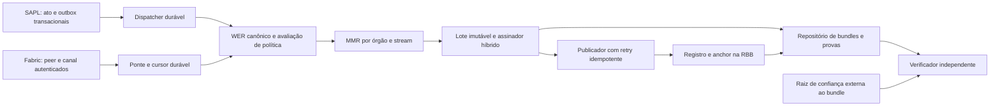

# Arkhe–RBB — especificação técnica consolidada

Versão: 0.2, 28/10/2026. Estado: arquitetura proposta para implementação incremental. Protocolo: `arkhe-evidence/3`, candidato de formato revisão 2, ainda não congelado. Responsáveis institucionais e aprovação: pendentes.

Esta versão substitui a [v0.1](ARKHE-RBB-ESPECIFICACAO-TECNICA-v0.1.md) para planejamento. A mudança do checkpoint CBOR/BLAKE3 para cabeçalho ABI/Keccak é incompatível com os bytes descritos na v0.1; os exemplos originais v2 também não são compatíveis. Nenhuma migração de dados ou alteração de código de produção foi executada. O [desenho de implementação e decisões](ARKHE-RBB-ARQUITETURA-v0.2.md) completa esta especificação com persistência, confiança, falhas e integração ao workspace.

## 1. Objetivo e interpretação

Registrar compromissos de evidências de atos setoriais, assiná-los com Ed25519 e ML-DSA e permitir verificar vínculo institucional, integridade, inclusão e ancoragem sob um modelo de confiança explícito. Esta especificação substitui as descrições conflitantes do anexo para fins de desenvolvimento futuro; não altera os exemplos nem declara que seus requisitos já estão implementados.

“DEVE”, “NÃO DEVE” e “PODE” indicam requisitos desta proposta. A aprovação destes requisitos pelo projeto não equivale à aprovação da governança da RBB.

Entregáveis de implementação: biblioteca de schemas/codec, acumulador e verificador, contratos de registro/ancoragem, adaptadores SAPL e Fabric, armazenamento durável, distribuição de bundles e documentação operacional. A [revisão de segurança](ARKHE-RBB-REVISAO-SEGURANCA-2026-10-28.md) explica os bloqueadores que motivam os requisitos.

## 2. Escopo e limites de confiança

O piloto DEVE preservar consenso e formato de transação da rede de destino. O escopo inicial é evidência de aplicação; alterações de consenso, TLS ou precompiles dependem de projeto e governança próprios. A adesão institucional, o tipo de nó, a versão de Besu, o hardfork EVM, o permissionamento e o genesis aplicável DEVEM ser confirmados antes da homologação de rede. Não presumir Cancun/Prague nem gas zero como propriedades universais da RBB.

O protocolo NÃO prova veracidade material, legalidade global, ausência de atos omitidos pela fonte nem resistência quântica de toda a rede. Gate é avaliador de política versionada e dados disponíveis. A cadeia registra declarações autorizadas; a aceitação criptográfica da evidência é um resultado adicional.

| Fronteira | Ativo protegido | Confiança ou verificação exigida |
|---|---|---|
| Sistema setorial → adaptador | Identidade e completude do evento | Revisão/ID estáveis, autorização da API e reconciliação |
| Adaptador → armazenamento | WER, sequência e cursor | Transação durável, exclusão mútua e idempotência |
| Assinador → publicador | Chaves e conteúdo autorizado | Serviço de assinatura autenticado, política e auditoria |
| Publicador → RBB | Ordem e compromisso de bytes | Conta autorizada, contrato conhecido e confirmação |
| Portal → cidadão | Bundle e verificador | Raiz externa de confiança, integridade do release e provas |
| Fabric → ponte | Origem e validade do commit | Peer/canal autenticados; confiança declarada na ponte |

Adversários considerados: fornecedor de bundle malicioso, operador comprometido, relayer adversarial, worker concorrente, replay de origem, broker/RPC indisponível, mudança de administrador, pacote malformado e cliente com versão divergente. Comprometimento do quórum raiz é risco residual explícito.

## 3. Arquitetura e responsabilidades

O gate decide elegibilidade para atestação de conformidade. Evidências de violações e de gaps DEVEM ser preservadas em fluxo de auditoria; rejeição de política não autoriza apagar o registro do ocorrido. O piloto NÃO bloqueia automaticamente a operação legislativa por falha remota do Arkhe.

Separação sugerida no fork: `arkhe/core`, `arkhe/contracts`, `arkhe/verifier`, `arkhe/adapters/sapl`, `arkhe/adapters/fabric`, `arkhe/policy`, `arkhe/schemas`, `arkhe/tests`, `arkhe/deploy`, `arkhe/docs`. Configuração de nós, se autorizada, permanece em `artefatos/`. Releases compilados podem ficar em canal de releases autenticado; versionar binários no Git não é requisito de reprodutibilidade.

## 4. Identidade, chaves e governança

REQ-ID-01: a identidade de rede DEVE incluir chain ID e hash do genesis. IDs institucionais DEVEM ser atribuídos em catálogo governado; hash de nome de órgão não prova atribuição institucional. Mudanças de nome preservam o ID.

REQ-ID-02: cada órgão possui streams e keysets versionados. Um keyset híbrido possui chaves Ed25519 e ML-DSA independentes, cada uma com algoritmo, ID, versão e janela de validade. A rotação de uma família NÃO DEVE revogar a outra. A ativação exige keyset completo e prova de posse das novas chaves sobre desafio vinculado ao órgão, contrato, rede, nonce e finalidade.

REQ-ID-03: cadastro, suspensão, recuperação, rotação do operador e mudança de verificadores DEVEM emitir eventos e preservar histórico. Não reinicializar nonce de identidade existente. Administradores, operadores, assinadores, publicadores e auditores são papéis separados. Administração de produção DEVE usar quórum documentado, troca de titularidade segura e recuperação ensaiada. O mecanismo concreto depende da plataforma aprovada.

REQ-ID-04: meta-transações DEVEM usar EIP-712 com tipos distintos para registrar, rotacionar e revogar. Todos incluem `orgId`, `operatorEpoch`, nonce sequencial e deadline. Rotação inclui índice e hash da chave antiga, nova chave/algoritmo, `validFrom` e `validUntil` explícitos. A autorização não depende de timestamp futuro escolhido pelo bloco. O contrato deve recalcular ou validar seu domínio para o chain ID vigente. Suporte a operador contratual exige mecanismo de assinatura compatível definido e testado; o caminho ECDSA atual só cobre EOA.

REQ-ID-05: timestamps de validade usam intervalo `[validFrom, validUntil)`. Registro possui também bloco/instante de efetivação, motivo de revogação e, quando conhecido, `compromiseNotBefore`. Uma data autodeclarada anterior à revogação não basta para preservação histórica: exigir evidência autenticada de existência anterior ao limite relevante ou retornar incerteza temporal. A suspensão operacional presente não apaga autorização histórica.

## 5. Perfil criptográfico

REQ-CR-01: o perfil inicial `HYBRID-ED25519-MLDSA44` exige ambas as assinaturas válidas sobre o mesmo digest. ML-DSA-65 pode ser perfil adicional após avaliação de capacidade e interoperabilidade; ML-DSA-87 fica reservado até habilitação explícita. Não negociar downgrade a partir de campos não autenticados.

| Algoritmo FIPS 204 | Chave pública | Assinatura | Categoria NIST |
|---|---:|---:|---:|
| ML-DSA-44 | 1.312 bytes | 2.420 bytes | 2 |
| ML-DSA-65 | 1.952 bytes | 3.309 bytes | 3 |
| ML-DSA-87 | 2.592 bytes | 4.627 bytes | 5 |

Referência: [FIPS 204](https://csrc.nist.gov/pubs/fips/204/final). Os valores não especificam chaves expandidas de uma precompile. Conformidade do algoritmo não implica certificação de biblioteca ou módulo HSM.

REQ-CR-02: Ed25519 DEVE aplicar parsing e verificação estritos de chave e assinatura, com vetores para pontos pequenos, assinaturas não canônicas e entradas inválidas. ML-DSA DEVE usar modo FIPS 204 puro sobre o digest externo de 32 bytes, contexto fixo ASCII `ARKHE_RBB_EVIDENCE_V3`; não confundir esse uso com HashML-DSA. Signer e verifier devem usar exatamente o mesmo contexto e modo.

REQ-CR-03: variantes `ML_DSA_*_ETH` são proibidas no perfil inicial. Trocar contexto não transforma FIPS 204 em variante ETH. EIP-8051 permanece dependência experimental; a revisão consultada é Draft. Sua interface DEVE ser implementada a partir de revisão fixada, nunca inferida do mock. [EIP-8051](https://eips.ethereum.org/EIPS/eip-8051).

REQ-CR-04: usar BLAKE3 com saída de 32 bytes para WER, manifestos e o perfil MMR explicitamente selecionado; usar Keccak-256 para identidade e digest assinado de checkpoint e compromisso do envelope, recalculáveis pela EVM. SHA-256 do release identifica o artefato distribuído. Os algoritmos e suas finalidades não são intercambiáveis. A mudança de hash do checkpoint é decisão de interoperabilidade, não alegação de aumento da resistência criptográfica.

REQ-CR-05: chaves de produção DEVEM ser utilizadas por serviço de assinatura com autorização e auditoria; a disponibilidade real de HSM para o algoritmo DEVE ser demonstrada. Settings com segredo hexadecimal em memória Python não constituem integração HSM. RNG de teste nunca entra em produção.

## 6. Codec e schemas comuns

REQ-ENC-01: WER, manifestos e atestações usam CBOR determinístico, sem floats, tags, comprimentos indefinidos ou campos duplicados. Mapas usam chaves inteiras não negativas atribuídas pelo schema, ordenadas pelo encoding CBOR; inteiros usam a menor largura. Digests, chaves e assinaturas são byte strings, não arrays de inteiros. Texto é UTF-8 com política de normalização definida no schema; não normalizar silenciosamente bytes já assinados. O cabeçalho de checkpoint e seu envelope usam ABI canônica conforme seção 6.2. Referência: [RFC 8949](https://www.rfc-editor.org/rfc/rfc8949.html).

REQ-ENC-02: cada tipo possui schema com mapa de campo→chave numérica, tipo, tamanho, obrigatoriedade e versão. Campos desconhecidos, enums fora do catálogo e bytes extras DEVEM ser rejeitados no núcleo v3. O adaptador JSON de transporte usa hex minúsculo para bytes e decimal textual para inteiros acima da faixa segura de JavaScript; JSON não é formato assinado. `repr(u8)`/derive Serde não substituem esse codec.

REQ-ENC-03: Rust e Python DEVEM compartilhar vetores com entrada lógica, CBOR hexadecimal, digest e assinaturas verificáveis. Aceitação exige bytes iguais, não apenas decodificação equivalente. Erro de serialização não pode produzir payload vazio ou hash zero como fallback.

### 6.1 WER de ato

O schema de WER DEVE conter versão, tipo, órgão, stream, ID único e revisão do evento de origem, instante declarado do ato, digest da política aplicada e conteúdo setorial mínimo. Para Legislativo, inclui vínculo explícito à intenção correta, versão da matéria, digests antes/depois e dados de decisão. Para Executivo/Fabric, inclui rede de origem, canal, chaincode, bloco, índice da transação, índice do evento, tx ID, digests autorizados e evidência de commit. Para Judiciário, adapter e política de sigilo permanecem pendentes.

`record_hash = BLAKE3(domain_wer || canonical_cbor(WER))`, com domínio fechado por tipo, por exemplo `AKG:LEG:ACT:v3\0` ou `AKG:EXEC:ACT:v3\0`. A sequência `\0` nesta especificação representa um único byte NUL, não dois caracteres literais. O consumidor NÃO DEVE escolher livremente o domínio a partir de uma string do bundle.

Estados desconhecidos devem ser representados como erro tipado ou ausência prevista no schema, nunca como digest zero com aparência de captura bem-sucedida. A política DEVE distinguir evidência incompleta de ato verificado.

### 6.2 Corpo assinado de checkpoint

O `CheckpointHeaderV3` é uma tupla ABI estática, com campos na ordem abaixo. Não há cópia CBOR autoritativa nem projeção paralela. Os índices identificam posições, não chaves de mapa. Tipos menores são codificados em palavras ABI de 32 bytes com padding canônico; `bytes32` e `address` seguem suas regras ABI distintas. Flags de presença distinguem ausência de digest zero. Valores ausentes exigem respectivo bytes32 zero, e presente exige digest não zero neste perfil.

| Chave | Campo | Tipo/semântica |
|---:|---|---|
| 0 | protocol_version | uint8, exatamente 3 |
| 1 | profile_id | uint16, catálogo do perfil criptográfico |
| 2 | anchor_chain_id | uint256 |
| 3 | anchor_genesis_hash | bytes32 |
| 4 | registry_address | address |
| 5 | anchor_address | address |
| 6 | org_id | bytes32 |
| 7 | power | uint8 1/2/3, conferido com registro |
| 8 | stream_id | bytes32 |
| 9 | sequence | uint64, começa em 1 |
| 10 | prev_checkpoint_id | bytes32, zero se ausente |
| 11 | first_leaf_index | uint64, primeira folha nova do lote |
| 12 | batch_leaf_count | uint64, maior que zero |
| 13 | total_leaf_count | uint64, tamanho cumulativo do MMR |
| 14 | mmr_root | bytes32, raiz vinculada ao contador |
| 15 | batch_manifest_digest | bytes32, compromisso da lista ordenada do lote |
| 16 | policy_digest | bytes32, política que rege este stream |
| 17 | declared_signed_at | uint64, segundos Unix |
| 18 | source_kind | uint8: 1 SAPL, 2 Fabric, 3 Judicial, 4 outro aprovado |
| 19 | source_network_id | bytes32, namespace atribuído à origem |
| 20 | source_manifest_digest | bytes32, zero se ausente conforme schema |
| 21 | ed25519_key_id | bytes32, ID autenticado do registro |
| 22 | mldsa_key_id | bytes32, ID autenticado do registro |
| 23 | keyset_version | uint64 |
| 24 | prev_present | bool, false apenas na sequência 1 |
| 25 | source_manifest_present | bool, obrigatório true para Fabric |
| 26 | mmr_profile_digest | bytes32, perfil MMR permitido para o stream |

O destino de ancoragem é dado pelos campos 2–5; `source_kind` não é confundido com o destino. Timestamp externo é uma prova adicional identificada no bundle, não um enum de blockchain de origem.

`header_bytes = abi.encode(CheckpointHeaderV3)` — 27 palavras, exatamente 864 bytes. `abi.encodePacked` não é permitido. `domain_hash = Keccak256(ASCII("AKG:CHECKPOINT:HEADER:v3") || 0x00)`.

`signing_digest = Keccak256(domain_hash || header_bytes)` — preimagem de 896 bytes. O contrato deriva domínio e digest da tupla recebida. As bibliotecas Rust, Python e Solidity devem produzir o mesmo valor conforme a [especificação ABI](https://docs.soliditylang.org/en/latest/abi-spec.html).

`checkpoint_id = signing_digest` — identificador do cabeçalho, independente da aleatoriedade das assinaturas e sem auto-referência. As duas assinaturas cobrem esse digest e os IDs de ambas as chaves através do cabeçalho. Ed25519 e ML-DSA assinam os 32 bytes diretamente, nos modos da seção 5; não aplicar prefixo Ethereum personal_sign.

`envelope_bytes = abi.encode(CheckpointHeaderV3, bytes(ed25519_signature), bytes(mldsa_signature))`. `envelope_commitment = Keccak256(envelope_bytes)`. O contrato recebe essa tupla tipada e as duas assinaturas e reconstrói os bytes; não hasheia offsets arbitrários de calldata. Consumidores de bytes ABI devem decodificar e recodificar, exigindo igualdade integral, padding zero e ausência de bytes extras. Reenvio DEVE usar o mesmo envelope persistido; não reassinar a mesma sequência a cada tentativa. O valor ocupa 3.488 bytes no perfil ML-DSA-44: 928 de head, 96 da assinatura Ed25519 e 2.464 da assinatura ML-DSA com comprimento/padding. Esse tamanho deverá ser confirmado por vetor diferencial antes de congelar o protocolo.

O manifesto de lote é lista ordenada de tuplas `[leaf_index, record_hash, source_event_id]`, canonicamente codificada. Seu domínio é `AKG:BATCH:MANIFEST:v3\0`. Deve permitir conferir contiguidade, número de folhas e referência a cada WER. Para MMR cumulativo: `first_leaf_index + batch_leaf_count == total_leaf_count`, com aritmética verificada; o lote seguinte começa no contador anterior.

### 6.3 Manifesto de origem Fabric

Todas as referências, inclusive lotes de uma transação, DEVEM usar o mesmo formato: rede, canal, chaincode e lista ordenada de `[block_number, tx_index, event_index, tx_id]`. O tx ID textual deve ser validado e convertido por regra única para bytes; não tratar o ID como hash genérico do conteúdo de toda a transação.

`source_manifest_digest = BLAKE3("AKG:FABRIC:MANIFEST:v3\0" || canonical_cbor(manifest))`.

Consultar um tx ID de dentro de um lote requer índice e prova do manifesto; não se promete que `mapping[txId]` encontra automaticamente um hash agregado. Namespace e cardinalidade dos índices DEVEM estar explícitos.

## 7. MMR e ordenação

REQ-MMR-01: um MMR cumulativo existe por `(org_id, stream_id)`. A ordem é atribuída pelo armazenamento durável; não depende da ordem de entrega do broker. Cada evento possui no máximo uma folha nesse stream, com índice único e contíguo. `mmr_profile_digest` autentica o algoritmo, formato de folhas, domínios, bagging e prova selecionados. O perfil permanece imutável dentro de um stream. O esquema abaixo é o candidato Arkhe-RBB v3; ele não é automaticamente equivalente ao perfil já congelado em `arkhe-verify-core`. O reuso deve preservar o perfil existente ou abrir stream com perfil novo explicitamente aprovado; não reinterpretar raízes anteriores.

Para índice i e hash r: `leaf = BLAKE3("AKG:MMR:LEAF:v3\0" || u64be(i) || r)`. Nó interno: `BLAKE3("AKG:MMR:NODE:v3\0" || left || right)`. Picos são mantidos da esquerda para a direita, com alturas estritamente decrescentes. Bagging da direita para a esquerda usa `BLAKE3("AKG:MMR:BAG:v3\0" || left_peak || accumulated_right)`; um único pico tem bag igual ao próprio pico.

Para n > 0, `root = BLAKE3("AKG:MMR:ROOT:v3\0" || u64be(n) || bagged_peaks)`. Checkpoint vazio é proibido. O valor de árvore vazia, se necessário internamente, não pode ser publicado como checkpoint não vazio.

REQ-MMR-02: prova contém índice, contador, siblings ordenados e picos complementares. O verificador deriva as montanhas da decomposição binária de n, localiza o pico-alvo e exige exatamente sua altura de siblings e os demais picos esperados. Direções derivam do índice local. Contador da prova DEVE ser igual ao assinado no corpo. Rejeitar overflow, índices fora da árvore, elementos extras e ausência de nós.

REQ-MMR-03: provas de inclusão demonstram pertinência; continuidade cumulativa entre checkpoints requer prova de extensão ou recomputação a partir de frontier autenticada. O produtor DEVE disponibilizar essa prova e o verificador só pode marcar `append_only_verified` após verificá-la. Uma sequência de hashes predecessores sozinha não prova extensão do MMR.

## 8. Contratos

REQ-SC-01: `KeyRegistry` mantém cadastro histórico, keysets e operador por órgão; impõe REQ-ID e consultas paginadas por ID/versão. `valid_from` declarado não pode fazer uma chave recém-registrada aparecer como autorizada em um bloco anterior ao cadastro.

REQ-SC-02: o anchor DEVE conferir órgão ativo, operador, poder e limites dos enums; existência explícita, sequência esperada, predecessor e progresso de folhas. Toda chave de armazenamento pertence a órgão e stream. Para a mesma sequência, conteúdo idêntico é retry idempotente; conteúdo diferente deve reverter. Zero não é sentinela de existência.

REQ-SC-03: a interface recebe `CheckpointHeaderV3` e as assinaturas. O contrato calcula `checkpoint_id` e `envelope_commitment` exatamente como a seção 6.2, verifica rede/contratos e usa diretamente os campos da tupla para indexação e progresso. Não aceita root, ID ou predecessor duplicados como parâmetros independentes. Comprimentos das assinaturas são conferidos pelo perfil, sem alegar verificação criptográfica. O genesis esperado é configuração imutável do deploy, não informação obtida automaticamente pelo contrato.

REQ-SC-04: o estado inicial é `RECORDED`. Verificação on-chain de ambas as assinaturas não é requisito do perfil inicial. Qualquer estado futuro `VERIFIED_ONCHAIN` exige implementação, política, codec e vetores próprios que comprovem exatamente o mesmo cabeçalho; autorização do operador não equivale a esse estado. Eventos devem conter órgão, stream, sequência, ID de checkpoint, compromisso, root, contador e bloco de registro. Extrair estado histórico autenticável faz parte do projeto do bundle. Atestadores externos avaliam evidência antes de produzir aceitação institucional; a ausência dessa aceitação não apaga o registro.

REQ-SC-05: retry idempotente compara ID e compromisso persistidos antes de conferir estado presente do órgão; uma consulta/repetição exata pode reconhecer registro histórico após suspensão, sem criar novo registro. Inserção nova sempre exige autorização vigente. Mesmo ID com assinaturas diferentes ou mesma sequência com ID diferente deve retornar conflito. Operador comprometido ainda pode publicar assinatura inválida do tamanho certo: congelar stream, registrar incidente e criar sucessor governado; jamais reescrever o registro ou saltar o erro silenciosamente.

REQ-SC-06: limites por transação, tamanho de envelope, uso de gas e política de pausa DEVEM ser medidos na rede aprovada. Endereços de precompile não são livremente trocáveis por um único operador. Mudanças de implementação DEVEM ter versão e política de migração; não alterar retroativamente o significado de envelopes.

## 9. Captura SAPL e processamento durável

REQ-SAPL-01: definir contrato de integração por versão SAPL comprovada, cobrindo criação, alteração, anulação e correção de ato, caminhos batch e importação. Os nomes de modelos e campos do anexo são exemplos até validação contra a versão instalada. Estado antes/depois DEVE ser capturado na transição de negócio, sob isolamento apropriado, e não presumido a partir de dois sinais ORM.

REQ-SAPL-02: gravação do ato e outbox DEVE ocorrer na mesma transação de negócio quando se promete captura atômica. Uma restrição única `(source_system, source_event_id, revision)` identifica a ocorrência. A indisponibilidade do broker/RBB não bloqueia o commit local; dispatcher consulta a tabela e tenta novamente. `on_commit` serve apenas para reduzir latência.

REQ-SAPL-03: a referência técnica do piloto é `ATOMIC_OUTBOX`, com ato e captura na mesma transação; falha local de persistência provoca rollback, enquanto falha de broker/RBB é desacoplada. Essa decisão precisa ser aceita pelo responsável pela origem antes de uso operacional. Se continuidade do negócio exigir prosseguir mesmo quando a outbox falha, usar `RECONCILED_CAPTURE`, habilitado somente após demonstrar journal/CDC independente e recuperação de gaps. Não se promete captura completa sem uma dessas garantias. O desenho v0.2 detalha ambos os modos.

REQ-WORK-01: claim, append MMR, associação de índice e avanço do evento DEVEM ser atômicos em armazenamento comum ou protocolo de commit recuperável equivalente. Serializar mutações por stream; eventos redeliverados retornam o índice já atribuído. Uma queda depois de qualquer write não pode duplicar folhas.

REQ-WORK-02: fechamento define watermark/revisão da origem e espera todos os eventos até essa barreira. Novos eventos após fechamento pertencem a lote de correção posterior. Lote selado é imutável; o predecessor confirmado só avança ao confirmar âncora. No piloto, congelar o próximo lote exige também aceitação do anterior; ingestão e append local podem continuar enquanto a atestação está pendente.

Máquina de publicação: `CAPTURED → POLICY_EVALUATED → MMR_COMMITTED → FROZEN → SIGNING → SEALED → SUBMITTED → CONFIRMED → ATTESTING → ACCEPTED`. Atuação de testemunhas pode resultar em `REJECTED`; falhas estruturais/operacionais preservam evidência em quarentena/incidente. Erros recuperáveis mantêm estado e tentativas. Conformidade é campo separado (`PASS`, `FAIL`, `INDETERMINATE`), não inferida do estágio de transporte. Um `tx_hash` representa `SUBMITTED`; `CONFIRMED` exige receipt de sucesso, destino/evento/compromisso esperados e finalidade conforme perfil da rede. `ACCEPTED` exige verificações e quórum do modo de confiança selecionado.

REQ-WORK-03: persistir envelope assinado antes da submissão, nonce EVM e hash da transação. Em timeout, consultar estado por órgão/stream/seq e compromisso antes de emitir nova transação. Reenvio não cria novo lote. Implementar backoff limitado, classificação de erros, dead letter e reconciliação periódica independente do broker.

## 10. Ponte Fabric

REQ-FAB-01: selecionar perfil de confiança `AUTHENTICATED_PEER_BRIDGE` para o piloto. A ponte autentica peer/certificado/MSP, canal, chaincode e rede, e processa apenas transações com commit VALID. Isso é uma atestação da ponte sobre origem; não prova independente de consenso Fabric no contrato RBB.

REQ-FAB-02: `DeliverFiltered` pode identificar status e disparar busca, mas não fornece payload do evento. Usar serviço completo ou busca autenticada com autorização mínima para dados necessários; nunca exportar private data por conveniência. [Documentação Fabric](https://hyperledger-fabric.readthedocs.io/en/latest/peer_event_services.html).

REQ-FAB-03: cursor durável contém rede, canal, bloco, tx/evento e identificador verificável do bloco quando disponível. Eventos têm chave única. Avançar para bloco seguinte somente após commit local de todos os eventos relevantes. Em reinício, reler fronteira e deduplicar. Cursor de leitura, frontier MMR, lote selado e confirmação RBB são estados distintos.

REQ-FAB-04: persistir pacote de origem autorizado suficiente para auditoria, política de validação e limitações. Timestamp do cliente ou evento não deve ser rotulado automaticamente como tempo certificado de endosso. A ponte deve filtrar e validar digests de entrada, não aceitar struct arbitrária como prova.

## 11. Política e ContainmentGate

REQ-POL-01: cada política contém autoridade, jurisdição, vigência, regras ordenadas, versão do avaliador, parâmetros e referências aprovadas. `policy_digest` cobre codec determinístico desses elementos. Política recebida no bundle precisa de autenticação; não é validada apenas porque o emissor forneceu seu hash.

REQ-POL-02: versões, órgãos/poderes, tipos de ato e regras desconhecidas resultam em `INDETERMINATE` ou rejeição estrutural. Quórum e prazos são derivados da política autenticada; não aceitos como exigência definida pelo próprio solicitante. Aritmética é verificada e o tempo atual deve vir de fonte explicitada.

REQ-POL-03: dois turnos exigem identificação de cada deliberação, turno válido, provas dos pré-requisitos, intervalo e regras de votação aplicáveis. Lista vazia não satisfaz pré-condição obrigatória. Conflito de interesses depende de regra aplicável e dados identificados; não generalizar a vedação ilustrativa do anexo a todo procedimento.

REQ-POL-04: resultado inclui `PASS/FAIL/INDETERMINATE`, digest da política, versão do avaliador, referências às entradas e violações tipadas. Nenhum resultado substitui decisão jurídica. A ausência de política completa não pode gerar selo verde.

## 12. Bundle e verificação independente

REQ-VER-01: bundle transporta envelope, WERs necessários, manifesto de lote/origem, prova MMR, prova de continuidade quando requerida, registro/keyset autenticado e prova de ancoragem. Chaves, receipt JSON e resultados `eth_call` isolados não são provas de autenticidade.

REQ-VER-02: o verificador inicia com trust configuration independente: rede/genesis, contratos e versão/code hash, políticas aceitas, referência temporal e raízes de confiança. Configuração fornecida pelo próprio bundle não pode substituir a configuração confiada sem atualização autenticada.

Há dois modos mutuamente identificados no relatório:

| Modo | Evidência exigida | Limite da conclusão |
|---|---|---|
| `QBFT_PROOF` | Cabeçalho confiado, cadeia/commits e transições autenticadas de validadores, prova de estado do registro e prova de estado/receipt do anchor | Verificação de ancoragem sob regras de consenso e trust anchor fixados |
| `TRUSTED_ATTESTATION` | Atestação assinada por quórum independente configurado, cobrindo rede, bloco, contratos, registro, envelope e âncora, com validade/frescura | Confiança nesse quórum; não anuncia verificação autônoma do consenso |

O piloto pode implementar o segundo modo primeiro, mas só o habilita após definir signatários, quórum, esquema, validade, revogação e cerimônia de distribuição da raiz. Sem modo implementado e validado, retornar `INDETERMINATE_TRUST`. Escolher um bloco recente sem provar mudança de validadores não implementa light client QBFT. Referência de consenso: [especificação QBFT](https://hub.entethalliance.org/client-spec/qbft_spec.html).

REQ-VER-03: conferir identidade de rede/contratos/órgão, chave e política histórica, assinaturas híbridas, WER/schema, manifesto, perfil MMR, continuidade exigida, ID do checkpoint e envelope commitment recalculados pela mesma ABI. Conferir limites temporais de compromisso/revogação, separando a primeira existência autenticada da data declarada. Os parâmetros concretos de atestação, armazenamento e recuperação estão no desenho de arquitetura v0.2.

REQ-VER-04: resultado usa estados `VALID`, `INVALID` ou `INDETERMINATE`, com propriedades independentes: `schema`, `signatures`, `institutional_binding`, `mmr_inclusion`, `append_only`, `anchor`, `policy`, `coverage`, `temporal_evidence`, `freshness`, `trust_mode` e códigos de erro. `VALID` só é emitido para a combinação de integridade/confiança exigida pelo perfil; propriedade não verificada nunca é implicitamente true. Política FAIL pode ser conteúdo de uma evidência íntegra; conformidade deve ser exibida separadamente e nunca inferida de VALID. Validade atual de revogação exige snapshot/frescura atual; um pacote offline antigo só sustenta conclusão “no bloco de referência”.

REQ-VER-05: `invalid_input` e `resource_limit` devem terminar sem panic, loop ilimitado ou acesso à rede inesperado. Limites iniciais propostos para homologação: bundle 8 MiB, WER 256 KiB, profundidade CBOR 16, até 64 siblings, até 64 picos e 4.096 entradas de manifesto. São tetos locais propostos, não capacidade comprovada. Envelopes ou lotes maiores exigem novo perfil e medição. Parsing e limites ocorrem antes da criptografia pesada.

## 13. Privacidade, publicação e operação

REQ-OPS-01: publicar somente dados necessários. Digests de dados pessoais não devem ser chamados de anônimos sem avaliação de reidentificação e correlação. Manter dados sensíveis e aberturas de compromisso em armazenamento autorizado, com retenção e acesso definidos. Quando necessário, usar aleatoriedade secreta por compromisso e política de revelação; salt público não elimina automaticamente ataque de dicionário. Referência: [estudo ANPD](https://www.gov.br/anpd/pt-br/centrais-de-conteudo/documentos-tecnicos-orientativos/estudo_tecnico_sobre_anonimizacao_de_dados_na_lgpd___analise_juridica.pdf/@@download/file).

REQ-OPS-02: releases devem incluir código/commit, lockfiles, toolchain, dependências, script de build, SBOM, hash e atestação de proveniência. Reproduzir em dois ambientes limpos e comparar bytes. Assinatura Sigstore exige identidade/issuer permitidos e validação do bundle de transparência segundo a política; não basta baixar hash e binário do mesmo servidor. [Sigstore](https://docs.sigstore.dev/cosign/verifying/verify/).

REQ-OPS-03: operar RPC com controle de acesso e métodos mínimos; não expor APIs administrativas/desbloqueio de contas. Dimensionar limites de gas/bloco, armazenamento e rate limiting. Evidências e provas devem ter retenção redundante, backup restaurável e teste de recuperação; disponibilidade histórica de calldata não é presumida em todo endpoint.

REQ-OPS-04: medir atraso de captura, tamanho/idade da outbox, gaps, eventos em quarentena, diferenças de reconciliação, retries, lotes selados sem âncora, falhas de assinatura, latência de confirmação e tempo de verificação. Métricas/logs não devem transportar payload sensível. Definir responsáveis e procedimento de incidente para chave comprometida, indisponibilidade e divergência de rede.

## 14. Plano de aceitação e rastreabilidade

| Teste obrigatório | Resultado esperado | Requisitos/achados |
|---|---|---|
| Bundle totalmente gerado pelo atacante com órgão vítima | Não produz vínculo institucional nem `VALID` | VER-01/02, A01 |
| Envelope divergente do commitment/cabeçalho registrado | `INVALID_ANCHOR_BINDING` | SC-03/05, A02 |
| Reusar assinatura de registro para rotação | Rejeição, mesmo nonce e timestamp | ID-04, A03 |
| Meta-transação incluída em bloco posterior | Funciona dentro de janela assinada | ID-04, A04 |
| Repetir seq com mesmo conteúdo e depois conteúdo diferente | Retry idempotente; divergência rejeitada | SC-02, A05 |
| Reusar envelope em outra rede/contrato/órgão | Rejeição de domínio/identidade | ID-01, ENC-03, A01/A05 |
| Assinar depois de comprometimento alegando tempo antigo | Sem prova anterior não obtém validade histórica plena | ID-05, A07 |
| MMR com 1, 2, 3, 5, 7, 8, 9, 13 folhas; todos os índices | Inclusão correta; contador/picos/siblings adulterados rejeitados | MMR-01/02, A08 |
| CBOR Python/Rust e ABI Python/Rust/Solidity com limites | Bytes e digests iguais; não canônico rejeitado | ENC-01/03, A09 |
| Falha após cada write e redelivery concorrente | Um evento, uma folha; nenhum lote perdido silenciosamente | WORK-01/03, A10/A11 |
| Encerrar sessão com worker atrasado e ato concorrente | Watermark completo ou lote pendente/correção explícita | WORK-02, A11 |
| Tx submetida que reverte ou fica sem inclusão | Nunca `CONFIRMED` | WORK-03, A11 |
| Fabric inválido, canal/chaincode errado e reinício no meio do bloco | Rejeição da origem errada; retomada idempotente | FAB-01/04, A12 |
| Política ausente, regra desconhecida, lista vazia e turno 3 | Sem `PASS`; motivo tipado | POL-01/04, A13 |
| Rotação só de ML-DSA no perfil híbrido | Ed25519 continua funcional e novo keyset verificável | ID-02, A14 |
| Vetores positivos/negativos reais Ed25519 e ML-DSA | Resultados conformes; mock não conta como prova criptográfica | CR-01/03, A06/A15 |
| Bundle enorme/profundo e histórico extenso | Rejeição limitada, sem exaustão | VER-05, A17 |
| Troca de Wasm/hash no portal | Release não autenticado rejeitado | OPS-02, A17 |

REQ-TEST-01: testes de falha e vetores DEVEM ser executados em CI com versões fixadas. Benchmarks separam captura, MMR, assinatura, tamanho, submissão, confirmação e verificação Wasm. Publicar hardware, topologia, versões, carga, distribuição p50/p95/p99, erros e método. SLAs numéricos serão aprovados após medir o piloto; os números do anexo não são resultados.

## 15. Marcos e decisões abertas

| Marco | Saída verificável | Condição para avançar |
|---|---|---|
| M0 — protocolo | Schemas, catálogo de campos/domínios, trust mode e política assinados pelo projeto | A01–A09 resolvidos em desenho; revisão técnica |
| M1 — núcleo local | Codec, assinaturas, MMR, gate e testes diferenciais | Vetores completos e negativos aprovados |
| M2 — integradores | SAPL em versão fixada e Fabric de teste com persistência | Fault injection/reconciliação sem perda silenciosa |
| M3 — homologação | Contratos e bundles com confiança autenticada em rede aprovada | Segurança e capacidade medidas; aceite institucional aplicável |
| M4 — piloto controlado | Operação monitorada, releases verificáveis e recuperação ensaiada | Responsáveis, privacidade e critérios de encerramento definidos |

Decisões bloqueantes: versão/configuração autorizada da RBB; identidade e quórum do trust mode inicial; mecanismo de administração e recuperação; política regimental da casa piloto; garantias de trilha SAPL; acesso/canal Fabric; política de exposição e retenção; capacidade e SLAs. Não há compromisso de implantação, ACT, parceria ou autorização para mensagens externas nesta proposta.

Esta versão é suficientemente concreta para revisão e planejamento do núcleo, mas o catálogo setorial completo de WER, o formato executável das atestações/provas de consenso e os parâmetros operacionais devem ser congelados e testados antes de declarar interoperabilidade ou prontidão de produção.
